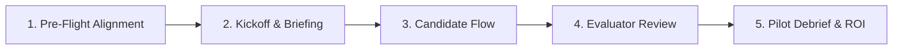

# Buyer Demo Script & Early Customer Discovery Package

**Product**: Hirearchy Software  
**Document Status**: Authoritative / Wave 2 Baseline  
**Audience**: Product Leads, Founders, Solution Engineers, Technical Sales, Design Partners

---

## 1. Overview & Objective

This package provides a battle-tested, structured playbook for conducting:

1. **Live Buyer Demonstrations** of Hirearchy Software based on the verified `Reservation Moves v3` scenario.
2. **Early Customer Discovery Interviews** with engineering leaders and hiring managers.
3. **Objection Handling** addressing common skepticism (lack of automated scores, AI cheating, staging restrictions).
4. **Supervised Alpha Pilot Engagement Checklist** for closing and running initial design partner pilots.

---

## 2. Step-by-Step Live Buyer Demo Script

**Scenario Featured**: `Reservation Moves v3` (Python backend scheduling and reservation logic).  
**Demo Duration**: 15–20 minutes.  
**Audience**: VP of Engineering, Engineering Director, Hiring Manager.  
**Core Narrative Arc**: "From task setup to verifiable human judgment in 15 minutes."

---

### Act 1: The Setup — Clean Scenario Issuance (2 minutes)

- **Screen**: Recruiter / Evaluator Portal (`/r23/login` -> `/r23/organizations/{orgId}/builder`)
- **Spoken Track**:
  > _"Welcome. Today we're looking at Hirearchy Software. Most technical hiring platforms force you to choose between two bad options: abstract LeetCode puzzles that candidates despise, or unstructured take-homes that take your senior engineers hours to grade._
  >
  > _Hirearchy does something different. We give candidates a bounded, realistic engineering scenario, record their observable actions chronologically, and give your evaluators an inspectable evidence workbench._
  >
  > _Let's start where a hiring manager starts: issuing an assessment. We select our approved template—in this case, 'Reservation Moves v3'—which presents a realistic backend reservation rescheduling problem. We assign a lead reviewer and generate the candidate session."_
- **Action on Screen**:
  1. Show Organization Selection and navigate to Assessment Builder.
  2. Select `Reservation Moves v3` template; review prompt instructions and acceptance criteria.
  3. Click **Issue Assessment** and display the Candidate Invitation panel with its unique session token.
- **Truthful Capability Boundary Note (Spoken)**:
  > _"Notice that the invitation link is presented directly in the recruiter interface with its secure access token. In our current demonstration and staging environments, automated SMTP email delivery is deliberately disabled so we don't send unsolicited messages from non-production hosts. In enterprise deployments, this integrates into your ATS or direct invite pipeline."_

---

### Act 2: The Candidate Experience — Realistic, Respectful Work (4 minutes)

- **Screen**: Candidate Consent (`/r26/candidate/{sessionId}#token`) -> Candidate Workspace
- **Spoken Track**:
  > _"Now let's step into the candidate's shoes. The candidate opens their invitation. There are no invasive webcam proctoring checks, no room scans, and no algorithmic traps._
  >
  > _Before starting, we provide clear, truthful disclosures: they see the scenario parameters, the time expectation, and clear rules. Once they consent, they enter the Candidate Workspace._
  >
  > _Here, they find a real multi-file codebase (`src/sender.py`, test harnesses, configuration files). They have an embedded CodeMirror editor, a file tree, and a terminal runner panel._
  >
  > _As the candidate edits code, saves revisions, and verifies their logic, Hirearchy captures discrete observable events—not invasive keystroke logging, but meaningful state changes."_
- **Action on Screen**:
  1. Open candidate link with `#token`. Check consent box and click **Start assessment**.
  2. Walk through the workspace layout: file tree on left, editor in center, instructions and terminal panel on right.
  3. Show the disabled live AI assistance badge and disabled live execution notice.
- **Truthful Capability Boundary Note (Spoken)**:
  > _"Notice this clear banner in the candidate console: live untrusted code execution and live AI co-pilot assistance are disabled in this environment pending our dedicated container isolation release gate. The candidate works against deterministic starter files and saves structured revisions. We never pretend an untrusted process ran when it didn't."_

---

### Act 3: Save, Resume & Submission (2 minutes)

- **Screen**: Candidate Workspace -> Submission Confirmation
- **Spoken Track**:
  > _"Candidates can save their progress at any time. If their network disconnects or they close their browser, their session state is durable and recovers cleanly upon return._
  >
  > _When they finish their implementation, they submit their work. The session immediately locks into an immutable, read-only state. The candidate sees a clear submission confirmation, and the evaluator queue is updated instantly."_
- **Action on Screen**:
  1. Click **Save draft**; point out the explicit saved notification.
  2. Refresh browser to prove durable session state recovery.
  3. Click **Submit assessment** and confirm submission. Show read-only confirmation screen.

---

### Act 4: The Core Value — Evaluator Evidence Workbench (6 minutes)

- **Screen**: Evidence Workbench (`/r27/organizations/{orgId}/sessions/{sessionId}`)
- **Spoken Track**:
  > _"This is the heart of Hirearchy: the Evaluator Evidence Workbench. Traditional tools give you a single opaque number like '84/100' or force you to watch an hour-long video recording._
  >
  > _Hirearchy presents a clean chronological reconstruction of the candidate's actual work. On the left is the timeline: session activation, every saved file revision with exact diffs, test executions, and final submission._
  >
  > _On the right is the inspector. When I click a timeline event, I see the exact code changes the candidate made at that point in time. I can follow their engineering reasoning: Did they start by reading the requirements? Did they write tests first? Did they encounter an edge-case and refactor cleanly?_
  >
  > _Now notice the Review tab. An evaluator does not just write generic feedback. In Hirearchy, every observation must be cited to a concrete piece of evidence—either a specific file revision or a timeline event."_
- **Action on Screen**:
  1. Navigate to the Evaluator Evidence Workbench for the submitted session.
  2. Click through the chronological timeline events (`Session activated`, `Workspace save recorded`, `Session submitted`).
  3. Expand a file diff to show code changes in context.
  4. Switch to the **Review** tab. Show the Human Review packet draft.
  5. Demonstrate adding an anchored observation: click an event, record an observation, cite it in the review packet under Strengths, Concerns, or Unresolved Questions.
  6. Click **Finalize review** to show immutable timestamped sign-off without candidate scores or rankings.

---

### Act 5: Debrief & Call to Action (2 minutes)

- **Spoken Track**:
  > _"Notice what never happened: the system never assigned a score, never labeled the candidate 'Junior' or 'Senior', and never decided who to hire. Your engineering team retains total ownership of the hiring verdict, but now that verdict is grounded in inspectable, auditable evidence._
  >
  > _In an engineering team debrief, you aren't debating vague impressions—you're looking at verifiable code diffs and cited observations._
  >
  > _We are currently onboarding 5 forward-thinking engineering teams into our Supervised Alpha Pilot program. Let's discuss how your team currently evaluates mid-to-senior candidates and see if an alpha pilot fits your upcoming hiring cycle."_

---

## 3. Early Customer Discovery Interview Script

**Format**: 30–45 minute video call.  
**Target Roles**: VP of Engineering, Head of Talent/Recruiting, Staff Engineer / Hiring Committee Lead.

### Phase 1: Context & Warm-Up (5 mins)

1. _"Can you walk me through your engineering hiring targets over the next 6 to 12 months?"_
2. _"What does your technical evaluation loop look like today from the moment a resume is approved to the onsite offer?"_

### Phase 2: Uncovering Current Workflow & Friction (10 mins)

1. _"What tooling do you currently use for technical screening (e.g. HackerRank, CodeSignal, CoderPad, take-home repos)?"_
2. _"What percentage of candidates who pass your initial technical screen end up failing the onsite engineering loop?"_
3. _"How much time do your senior/staff engineers spend per week grading take-homes or conducting technical screens?"_
4. _"How does your team handle generative AI today? Do candidates use Copilot/ChatGPT, and how does your evaluation account for that?"_
5. _"When your hiring team holds a candidate debrief, where do disagreements usually arise? What evidence do interviewers bring to the table?"_

### Phase 3: Live Hirearchy Demonstration (15 mins)

- Run the 12-minute Live Buyer Demo Script (Act 1 through Act 4 above).
- Pause intentionally at the **Evidence Workbench**:
  > _"When you look at this chronological reconstruction and source-anchored citations, how does this compare to the notes your engineers submit today in Greenhouse/Lever?"_

### Phase 4: Validating Differentiators & Willingness to Engage (10 mins)

1. _"We deliberately don't give candidates a numerical score or pass/reject label. How does your engineering leadership feel about keeping the evaluation decision 100% human-owned?"_
2. _"If your evaluators could review a candidate's complete problem-solving arc in 6 minutes with verifiable diffs, what would that do to your team's interviewing load?"_
3. _"What would prevent you from testing this alongside your current process on your next 5 backend engineering candidates?"_

### Phase 5: Next Steps & Pilot Qualification (5 mins)

- If qualified (active hiring, senior engineer buy-in): Introduce the **Supervised Alpha Pilot**.
- If not hiring now: Ask permission to reconnect at their next hiring surge and request introductions to peer engineering leaders.

---

## 4. Objection Handling Matrix

| Common Objection                                                    | Root Cause / Concern                                                                                | Grounded, Defensible Response                                                                                                                                                                                                                                                                                                                                                                                                                                                                                                                                 |
| :------------------------------------------------------------------ | :-------------------------------------------------------------------------------------------------- | :------------------------------------------------------------------------------------------------------------------------------------------------------------------------------------------------------------------------------------------------------------------------------------------------------------------------------------------------------------------------------------------------------------------------------------------------------------------------------------------------------------------------------------------------------------ |
| **"Why don't you provide an automated score or pass/fail cutoff?"** | Buyer is accustomed to HackerRank/CodeSignal automated filtering to reduce recruiter review volume. | _"Automated scoring creates false precision. Two candidates who both pass 4 out of 5 tests might have completely different competence: one wrote clean, maintainable, extensible code with an edge-case miss; the other wrote hacky, unmaintainable code that hardcoded inputs. If an algorithm filters out the first candidate, you've lost a great engineer. Hirearchy reduces senior reviewer time from 45 minutes down to 6 minutes while keeping the hiring decision in the hands of your team."_                                                        |
| **"How do you catch candidates cheating with ChatGPT or Claude?"**  | Buyer fears AI-generated code will trick interviewers and dilute hiring bars.                       | _"AI detectors and typing heuristics are notorious for false positives and create an adversarial dynamic with candidates. Instead of guessing invisible mental states or trying to detect AI origins, Hirearchy focuses on realistic bounded scenarios. A candidate still has to understand the codebase, make correct architectural tradeoffs, resolve edge cases, and save coherent revisions. Because the work is reconstructed chronologically with verifiable diffs, your evaluators can immediately see whether the candidate understood the problem."_ |
| **"Can candidates run their code live right now?"**                 | Buyer expects an interactive REPL or container runner in the browser.                               | _"In our current demonstration and staging environment, live candidate execution is deliberately disabled until our hardened gVisor container sandbox meets its security release gates. Rather than executing untrusted code on shared infrastructure, the candidate works against deterministic starter files and test harnesses. Full sandboxed execution will activate once operational isolation gates are satisfied."_                                                                                                                                   |
| **"Does this integrate with Greenhouse, Lever, or Ashby?"**         | Buyer wants a seamless ATS candidate-sync workflow.                                                 | _"For our initial Alpha release, Hirearchy operates as a lightweight, focused assessment workbench: recruiters issue sessions directly and copy candidate links into your ATS notes. Direct webhook and REST ATS integrations are part of our enterprise roadmap once core evaluation workflows are validated with design partners."_                                                                                                                                                                                                                         |
| **"Can we create our own custom scenarios?"**                       | Buyer wants tests tailored to their proprietary stack.                                              | _"Our primary focus in Alpha is curating vetted, high-signal bounded scenarios like `Reservation Moves v3` that test foundational engineering skills without requiring days of setup. During our Supervised Alpha Pilot, we partner with your engineering leads to map our scenarios directly to your team's technical expectations."_                                                                                                                                                                                                                        |

---

## 5. Supervised Alpha Pilot Engagement Checklist

**Pilot Goal**: Run 5 to 10 active candidate evaluations across 2 to 4 weeks with zero engineering setup overhead.

### 1. Pre-Flight Alignment (1 week before launch)

- [ ] Identify 1 target engineering role (e.g. Mid/Senior Backend Engineer).
- [ ] Identify 1 Lead Hiring Manager and 2 designated Evaluators.
- [ ] Review the `Reservation Moves v3` scenario parameters to ensure alignment with the team's technical bar.
- [ ] Establish success criteria:
  - Average evaluator review time ≤ 10 minutes.
  - Reviewer confidence rating ≥ 4 out of 5 in debrief.
  - Candidate completion rate ≥ 80%.

### 2. Kickoff & Evaluator Briefing (30 minutes)

- [ ] 20-minute briefing with designated evaluators on navigating the Evidence Workbench.
- [ ] Demonstrate anchoring observations to timeline events and file revisions.
- [ ] Reiterate core evaluation philosophy: no scoring; focus on code structure, tradeoffs, and cited evidence.
- [ ] Provide evaluators with the Review Packet rubric guidelines.

### 3. Live Candidate Flow (2–3 weeks)

- [ ] Recruiter issues assessment via Hirearchy portal.
- [ ] Candidate link shared via existing candidate communication channel (with explicit notice on assessment parameters and disabled SMTP).
- [ ] Candidate completes workspace session within allocated time window.

### 4. Evaluator Review & Finalization

- [ ] Evaluator receives notification of submitted session.
- [ ] Evaluator inspects chronological timeline, reviews diffs, and creates anchored review packet.
- [ ] Evaluator finalizes review before the candidate debrief.

### 5. Pilot Debrief & Conversion Evaluation

- [ ] Compare Hirearchy review speed and signal quality against the team's legacy screening process.
- [ ] Review candidate feedback regarding the assessment experience.
- [ ] Reviewer satisfaction survey: Did the evidence make the debrief faster and more decisive?
- [ ] Transition design partner into commercial annual pilot.
