# Competitive Positioning & Market Analysis

**Product**: Hirearchy Software  
**Document Status**: Authoritative / Wave 2 Baseline  
**Audience**: Product, Go-To-Market, Engineering Leadership, Customer Discovery

---

## 1. Executive Summary

Technical assessment software has bifurcated into two dominant categories:

1. **Algorithmic Screening Platforms** (HackerRank, TestGorilla, CodeSignal Pre-Screen) that rely on short, puzzle-like challenges and automated unit-test scores to produce a numerical candidate score or pass/fail cutoff.
2. **Interactive Developer Environments & Interview Platforms** (CoderPad, CodeSignal IDE, Karat) that provide multi-file workspaces, live pair-programming pads, and AI co-pilots, but either lack a structured, citable human evaluation workflow or require expensive outsourced human interviewers.

With the rapid emergence of generative AI coding assistants, both models face critical friction:

- **Algorithmic platforms** attempt to detect AI usage through error-prone heuristics (copy-paste tracking, window blur, behavioral anomaly scores), creating false positives, candidate alienation, and arms-race dynamics.
- **AI-enabled assessment tools** attempt to grade "AI collaboration skills" using automated prompts and synthetic scoring metrics, obscuring candidate competence behind opaque AI summaries.

**Hirearchy Software** rejects both extremes. Hirearchy is a bounded, role-relevant engineering assessment platform built on one core principle: **Evidence informs; people decide.**

Hirearchy does not generate candidate scores, algorithmic competence labels, or automated hiring verdicts. Instead, it provides a controlled, realistic engineering scenario (such as `Reservation Moves v3`) that captures observable candidate events into a chronological reconstruction. Human evaluators inspect the actual record of work—saved file revisions, test runs, and candidate commentary—and anchor every observation directly to verifiable source evidence.

---

## 2. Competitive Landscape & Published Pricing Reference

| Competitor            | Core Evaluation Model                                                                                               | Published Pricing / Commercial Model                                                                                                                                                                    | Candidate Experience                                                                                                          | AI Policy & Capabilities                                                                                              | Key Limitations & Buyer Pain Points                                                                                                               |
| :-------------------- | :------------------------------------------------------------------------------------------------------------------ | :------------------------------------------------------------------------------------------------------------------------------------------------------------------------------------------------------ | :---------------------------------------------------------------------------------------------------------------------------- | :-------------------------------------------------------------------------------------------------------------------- | :------------------------------------------------------------------------------------------------------------------------------------------------ |
| **HackerRank**        | Automated unit-test scoring on algorithmic / syntax challenges; live pair-programming (_Interview_).                | • **Starter**: ~$199/mo ($948–$1,990/yr billed annually), 60–120 attempts/yr. • **Pro**: ~$449/mo ($4,490/yr), ~300 attempts/yr. • **Enterprise**: Custom quote. • Overages: ~$15–$20/attempt. | Puzzle-heavy coding tests in web editor; perceived as high-stress "LeetCode trivia" disconnected from day-to-day engineering. | Automated plagiarism detection and AI code pattern matching; attempts to detect and deter external AI use.            | Opaque score cutoffs eliminate qualified engineers; high false-positive rate on proctoring; high candidate resentment.                            |
| **CodeSignal**        | Automated pre-screening (_Coding Score_); AI-assisted coding evaluations; conversational AI interviewers (_Cosmo_). | • **Build**: ~$79–$99/mo (annual commitment). • **Grow**: ~$479/mo. • **Enterprise**: Custom contract. • Credit-based consumption (~$20/overage credit).                                       | Multi-file IDE; conversational AI interviewer screens; AI co-pilot (_Cosmo_) inside IDE for supported tests.                  | AI-native approach: embeds GPT-4o assistant in IDE; scores "AI collaboration proficiency"; automated AI interviewers. | Evaluates candidates via AI conversational proxies and automated scores; complex credit metering; automated ranking.                              |
| **CoderPad**          | Realistic coding pads (_Interview_) and take-home tests (_Screen_); terminal and multi-file framework support.      | • **Starter**: ~$80/mo (40+ languages, baseline pad). • **Team**: ~$400/mo (Screen + Interview, ~20 custom questions). • **Frontier / Enterprise**: ~$1,000/mo to custom annual contracts.        | Familiar developer environment with terminal, packages, and code playback; candidate-friendly live pads.                      | Embedded AI assistant (_AI Assist_); records prompt histories and playback; supports Claude Code/agent pads.          | Lacks an anchored human evaluation workbench; evaluators take free-form unstructured notes not cited to verifiable evidence.                      |
| **TestGorilla**       | Broad multi-subject library (cognitive, personality, basic language quizzes); light coding questions.               | • **Free**: $0/mo (10 credits/mo, basic tests). • **Core**: ~$215/mo ($2,580/yr billed annually). • **Plus**: ~$520/mo ($6,240/yr billed annually, required for custom coding & ATS).             | Multiple-choice questions mixed with short single-file coding snippets; rigid timer limits.                                   | Anti-cheating proctoring (webcam snapshots, mouse/tab tracking); basic code checks.                                   | Unsuitable for real engineering: no realistic multi-file repository, dependency resolution, or observable problem-solving.                        |
| **Karat / Byteboard** | Project-based asynchronous assignments (Byteboard) + outsourced live human interviewers (Karat IVEs).               | • **Custom Enterprise Contracts**: Billed per completed technical interview (typically hundreds of dollars per interview). • High annual spend commitments ($50k–$250k+).                            | Context-rich asynchronous project tasks with codebases and requirements; anonymized rubric grading.                           | Open-book philosophy; evaluates rubric criteria across software engineering dimensions.                               | Extremely costly per-interview outsourced service; engineering teams outsource interviewing rather than inspecting candidate evidence themselves. |

---

## 3. What Competitors Do Well (Acknowledged Industry Capabilities)

To maintain absolute credibility with engineering buyers, Hirearchy does **NOT** claim false differentiation. We acknowledge standard industry capabilities:

1. **Multi-File & Framework Environments**: CoderPad, CodeSignal, and HackerRank modern environments already support multi-file projects, package managers, and terminal access. Hirearchy does not claim to have invented the browser-based IDE.
2. **AI Co-Pilots in Assessments**: CodeSignal (Cosmo) and CoderPad (AI Assist) already allow candidates to use large language models during assessments. Hirearchy does not claim that allowing AI in an assessment is unique.
3. **Take-Home Auto-Graders & Code Playback**: CoderPad and HackerRank provide keystroke playback and test-runner execution.

---

## 4. Hirearchy’s Genuine Differentiation: The Four Pillars

Where competitors focus on **automating the verdict** or **outsourcing the interview**, Hirearchy focuses on **making evidence legible and holding human evaluators accountable to inspectable facts**.

```mermaid
flowchart TD
    subgraph Competitor Approach [Traditional / AI-Automated Approach]
        C1[Candidate Workspace] --> C2[Automated Grading & AI Summaries]
        C2 --> C3["Algorithmic Score / Pass-Fail Verdict (82%)"]
        C3 --> C4[Opaque Hiring Decision]
    end

    subgraph Hirearchy Approach [Hirearchy Evidence-First Approach]
        H1[Realistic Scenario: Reservation Moves v3] --> H2[Chronological Observable Event Stream]
        H2 --> H3[Evaluator Evidence Workbench]
        H3 --> H4["Human Observations (Anchored to File Revisions & Events)"]
        H4 --> H5["Immutable Human Review (Evaluator Owns Verdict)"]
    end
```

### Pillar 1: Evidence Precedes Judgment (The Chronological Reconstruction)

- Competitors either compress hours of work into a single score (e.g., "78% on Algorithmic Efficiency") or force evaluators to scrub through a 90-minute video recording.
- Hirearchy records discrete, observable milestones: environment activation, file revisions saved with diffs, test executions, and final submission.
- The Evaluator Evidence Workbench presents one unified chronological reconstruction. An evaluator can reconstruct the candidate’s problem-solving arc in 5–8 minutes without losing access to raw source files.

### Pillar 2: The Evaluator Owns the Verdict (No Automated Scoring)

- **Non-negotiable rule**: Hirearchy NEVER produces candidate numerical scores, rankings, competence percentiles, or automatic pass/reject recommendations.
- Automated scoring in software engineering creates false precision. Two candidates who both pass 4 out of 5 tests may have radically different engineering competencies: one wrote clean, maintainable, extensible code with an edge-case miss; the other wrote unmaintainable spaghetti code that happened to satisfy the test harness.
- In Hirearchy, the human evaluator writes the review packet (noting strengths, concerns, and unresolved questions) and signs off immutably. The tool informs; humans decide.

### Pillar 3: Source-Anchored Observation Provenance

- In standard tools, hiring manager feedback consists of vague impressions ("Candidate seemed hesitant", "Good Python skills") written in disconnected ATS comment boxes.
- In Hirearchy, an evaluator cannot record an observation without linking it directly to an inspectable piece of evidence:
  - A specific `file_revision` (inspecting exact code diffs and changes).
  - A specific `timeline_event` (inspecting test outcomes or workspace milestones).
- When a hiring team convenes for a debrief, every claim is verifiable. If an evaluator notes "Candidate introduced concurrency regression," teammates can click the citation and view the exact lines changed.

### Pillar 4: Neutral AI Recording Without Mental State Inference

- Competitors attempt to play "AI police", analyzing typing cadences or running LLM detectors to generate "cheating probability" scores that alienate candidates and misfire constantly.
- Hirearchy treats AI interaction as neutral observable data:
  - Observable interactions with integrated tooling are recorded faithfully as events.
  - The system never infers invisible mental states (e.g., "Candidate understood the algorithm" or "Code was pasted from ChatGPT").
  - The evaluator decides whether the observable work demonstrates the competence required for the role.

---

## 5. Value Proposition by Stakeholder

### For Engineering Leaders (VPs of Engineering, Directors, CTOs)

- **Protect Senior Engineering Time**: Senior engineers spend 15–25% of their week interviewing candidates who passed automated screens but fail basic engineering tasks onsite. Hirearchy gives senior engineers a 6-minute evidence review that accurately predicts onsite technical depth.
- **Auditability & Fair Process**: Debriefs are anchored to inspectable code revisions rather than subjective impressions, reducing hiring bias and improving team alignment.
- **Defensible Decisions**: No black-box AI algorithms make hiring decisions. Your team retains full governance and compliance control.

### For Engineering Hiring Managers & Interviewers

- **No LeetCode Grinding**: Test candidates on realistic scenarios (e.g. distributed reservation adjustments, API validation, race conditions) that mirror your real codebase.
- **Fast, High-Fidelity Review**: Instead of grading a take-home from scratch or re-running broken local environments, the Evidence Workbench presents diffs, timeline chronology, and test outputs in one pre-configured workspace.
- **Evidence-Based Debriefs**: Never argue over fuzzy interview impressions again. Every point on your review packet links to a line of code or a recorded event.

### For Candidates

- **Respect for Realistic Work**: Candidates solve a practical, role-relevant engineering problem with clear acceptance criteria rather than reversing binary trees on a whiteboard.
- **No Dehumanizing Proctoring**: No invasive webcam monitoring, room scans, or algorithmic cheating flags.
- **Fair Human Evaluation**: Candidates know their work will be reviewed by an actual human engineer who can see their engineering tradeoffs, not discarded by an automated filter because of an off-by-one error.

---

## 6. Claims to Make vs. Claims to Avoid

To maintain rigorous truthfulness across marketing, sales, and customer discovery, adhere strictly to this guide:

| Category                    | ✅ Claims to Make (Grounded & Defensible)                                                                                                                                                                           | ❌ Claims to Avoid (Misleading or Overstated)                                                                                   |
| :-------------------------- | :------------------------------------------------------------------------------------------------------------------------------------------------------------------------------------------------------------------ | :------------------------------------------------------------------------------------------------------------------------------ |
| **Scoring & Verdicts**      | "Hirearchy gives your engineers verifiable evidence so they can make confident, human-owned hiring decisions."                                                                                                      | "Hirearchy automatically identifies top 1% engineering talent" or "Our AI grades candidates with 99% accuracy."                 |
| **Evidence & Review**       | "Every evaluator observation is formally anchored to a specific file revision or timeline event."                                                                                                                   | "We eliminate the need for engineering interviews" or "Our platform makes hiring 10x faster."                                   |
| **AI Assessment**           | "We record observable interactions neutrally, without guessing candidate thoughts or generating misleading suspicion scores."                                                                                       | "We have an un-cheatable AI detector" or "We measure prompt engineering genius."                                                |
| **Realistic Tasks**         | "Candidates work on bounded, role-relevant engineering repositories with realistic starter code and test harnesses."                                                                                                | "We have the largest question library in the world" or "We generate instant custom assessments on any framework automatically." |
| **Current Prototype State** | "In our current demonstration environment, candidate code execution and live AI assistance are deliberately disabled pending operational isolation gates; all evaluations run against deterministic recorded work." | "We offer full instant sandboxed cloud execution for every candidate globally today."                                           |
| **Email & Delivery**        | "Account and session links are provided directly in the recruiter interface while automated SMTP delivery is disabled in staging."                                                                                  | "Automated candidate email invitations and reminder workflows are sent seamlessly from the app."                                |

---

## 7. Target Ideal Customer Profile (ICP)

### Primary ICP: High-Bar Engineering Teams (Series A to Growth Stage)

- **Company Profile**: 25 to 250 engineers; building high-reliability software (FinTech, Developer Infrastructure, Enterprise B2B SaaS, HealthTech).
- **Key Decision Maker**: VP of Engineering, Head of Engineering, Director of Infrastructure/Backend.
- **Key Champion**: Staff / Principal Engineer or Hiring Manager tired of LeetCode screens and grading unstructured take-home assignments.
- **Current Pains**:
  - High onsite failure rate: Candidates with glowing resumes or high HackerRank scores bomb practical code-review or architecture rounds.
  - Candidate drop-off: Senior candidates refuse to take 4-hour LeetCode tests or submit to invasive webcam proctoring.
  - Interviewer burnout: Senior engineers spend hours reviewing ambiguous GitHub repo submissions without knowing how the candidate arrived at the solution.
- **Willingness to Pay**: High. A single bad senior engineering hire costs $100k+ in recruiting fees and wasted time; reclaiming 10 hours of staff engineer time per week yields immediate ROI.
